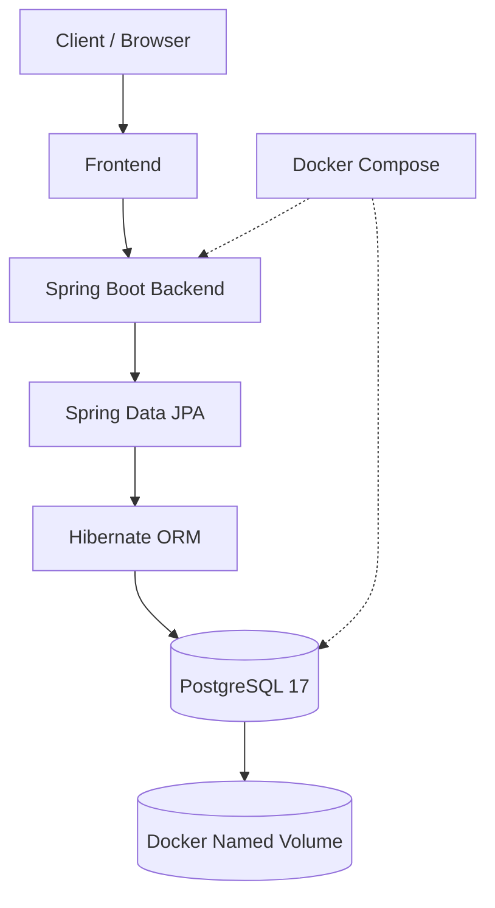

# 💊 Pharmez – Pharmacy E-Commerce Web Application

Pharmez is a pharmacy e-commerce web application designed to simulate an online medical store. It provides a responsive interface for browsing healthcare products and a Spring Boot backend for managing product information through REST APIs.

The application combines a web-based frontend, Java Spring Boot backend, and PostgreSQL database. Docker and Docker Compose are used to containerize and manage the backend and database services.

---

## 🚀 Features

### 🛍️ Customer Features
- Browse pharmacy products.
- View product listings and details.
- Search products by name.
- Filter products by category.
- Shopping cart functionality.
- Checkout page.
- Informational pages:
  - About
  - Contact
  - Blog
  - FAQ
  - Services
  - Team
  - Privacy Policy

### ⚙️ Admin Features
- Admin dashboard.
- Add new products.
- Update existing products.
- Delete products.
- View product information.
- Manage product data through REST APIs.

### 🔧 Backend Features
- RESTful API development using Spring Boot.
- CRUD operations for product management.
- Layered architecture.
- Database integration using Spring Data JPA.
- Hibernate ORM.
- PostgreSQL database connectivity.
- Environment-based database configuration.

### 🐳 DevOps & Deployment Features
- Dockerized Spring Boot application.
- Multi-stage Docker builds.
- Docker Compose orchestration.
- Separate backend and database containers.
- Container-to-container communication.
- PostgreSQL health checks.
- Persistent database storage using Docker volumes.
- Environment variable-based configuration.
- Container restart policies.

---

## 🛠️ Technology Stack

| Category | Technology |
|---|---|
| Frontend | HTML5, CSS3, JavaScript |
| Backend | Java 21, Spring Boot |
| API | Spring Web (REST APIs) |
| Database | PostgreSQL 17 |
| ORM | Spring Data JPA, Hibernate |
| Build Tool | Maven |
| Containerization | Docker |
| Orchestration | Docker Compose |
| Version Control | Git, GitHub |

---

## 🏗️ System Architecture

Pharmez follows a multi-container architecture in which the Spring Boot backend communicates with the PostgreSQL database through an internal Docker network.



### Container Architecture

| Service | Technology | Port |
|---|---|---|
| Backend | Spring Boot | 8080 |
| Database | PostgreSQL 17 | 5432 (internal) |

**Database Connection URL:**

```text
jdbc:postgresql://db:5432/pharmez
```

Here, `db` is the PostgreSQL service name defined in `compose.yaml`.

Docker's internal DNS allows the backend container to communicate with the database container using this service name.

---

## 📁 Project Structure

```text
pharmez/
│
├── pharmez-backend/
│   ├── src/
│   │   └── main/
│   │       ├── java/
│   │       │   └── com/pharmez/
│   │       │       ├── controller/
│   │       │       ├── model/
│   │       │       ├── repository/
│   │       │       ├── service/
│   │       │       └── PharmezApplication.java
│   │       │
│   │       └── resources/
│   │           ├── application.properties
│   │           └── data.sql
│   │
│   └── pom.xml
│
├── Dockerfile
├── compose.yaml
├── .dockerignore
├── .gitignore
├── .env.example
└── README.md
```

---

## ⚙️ Prerequisites

Install the following tools before running the application.

- Git
- Docker Desktop
- Docker Compose

For local development without Docker:

- Java JDK 21
- Maven
- PostgreSQL

---

## 🚀 Getting Started

### 1. Clone the Repository

```bash
git clone https://github.com/manoharan12105-beep/pharmez.git

cd pharmez
```

### 2. Configure Environment Variables

Create a `.env` file in the project root directory.

Use `.env.example` as a reference.

**.env**

```env
POSTGRES_DB=pharmez
POSTGRES_USER=postgres
POSTGRES_PASSWORD=your_secure_password
```

Replace the placeholder password with a secure password.

**Important:** Never commit the actual `.env` file to GitHub. It should be excluded through `.gitignore`.

### 3. Build and Start the Application

Execute the following command from the project root:

```bash
docker compose up --build -d
```

Docker Compose performs the following operations:

1. Builds the backend Docker image.
2. Creates the backend container.
3. Pulls the PostgreSQL 17 image.
4. Creates the database container.
5. Creates an internal Docker network.
6. Creates a persistent database volume.
7. Checks database readiness using a health check.
8. Starts the backend after the database becomes healthy.

### 4. Verify Running Containers

```bash
docker compose ps
```

View application logs:

```bash
docker compose logs -f
```

View backend logs:

```bash
docker compose logs -f backend
```

View database logs:

```bash
docker compose logs -f db
```

### 5. Access the Application

Backend:

```text
http://localhost:8080
```

Product REST API:

```text
http://localhost:8080/api/products
```

The frontend pages can be opened separately in a browser. If they use backend APIs, ensure the backend is running.

---

## 🐳 Docker Implementation

### 1. Multi-Stage Docker Build

The project uses a multi-stage Dockerfile to build and run the Spring Boot application.

**Stage 1 – Build Environment**

```dockerfile
FROM maven:3.9-eclipse-temurin-21 AS build

WORKDIR /app

COPY pharmez-backend/pom.xml .

COPY pharmez-backend/src ./src

RUN mvn clean package -DskipTests
```

Responsibilities:

- Uses Maven with JDK 21.
- Copies the backend Maven configuration.
- Copies the Java source code.
- Builds the executable Spring Boot JAR.

**Stage 2 – Runtime Environment**

```dockerfile
FROM eclipse-temurin:21-jre

WORKDIR /app

COPY --from=build /app/target/*.jar app.jar

EXPOSE 8080

ENTRYPOINT ["java", "-jar", "app.jar"]
```

Responsibilities:

- Uses a lightweight Java runtime image.
- Copies the generated JAR from the build stage.
- Exposes application port 8080.
- Starts the Spring Boot application.

**Benefits of Multi-Stage Builds:**

- Separates build-time and runtime dependencies.
- Avoids including Maven in the final runtime image.
- Reduces unnecessary image contents.
- Produces a cleaner deployment artifact.

### 2. Docker Compose

The `compose.yaml` file defines two services.

**Backend Service**

- Builds the application using the root Dockerfile.
- Exposes port 8080.
- Receives database credentials through environment variables.
- Depends on the database health check.
- Uses the `unless-stopped` restart policy.

**Database Service**

- Uses the official PostgreSQL 17 image.
- Initializes the database using environment variables.
- Uses `pg_isready` for health monitoring.
- Stores data in a named Docker volume.
- Uses the `unless-stopped` restart policy.

### 3. Container Networking

Docker Compose automatically creates a network for the services.

The backend connects to PostgreSQL using:

```text
jdbc:postgresql://db:5432/pharmez
```

**Why not localhost?**

Inside a container, `localhost` refers to that same container.

Therefore, the backend uses `db`, which is the database service name, to communicate with the PostgreSQL container.

### 4. Database Persistence

Docker Compose defines a named volume:

```yaml
volumes:
  postgres_data:
```

The volume is mounted at:

```text
/var/lib/postgresql/data
```

This ensures PostgreSQL data survives container removal and recreation.

**Stop containers:**

```bash
docker compose down
```

This removes containers but preserves the named volume.

**Remove containers and volumes:**

```bash
docker compose down -v
```

**Warning:** The second command deletes the associated database volume and its stored data.

---

## 🔗 REST API Endpoints

**Base URL:**

```text
http://localhost:8080/api/products
```

| HTTP Method | Endpoint | Description |
|---|---|---|
| GET | `/` | Retrieve all products |
| GET | `/{id}` | Retrieve product by ID |
| GET | `?search=name` | Search products |
| GET | `?category=Vitamin` | Filter products by category |
| POST | `/` | Add a new product |
| PUT | `/{id}` | Update an existing product |
| DELETE | `/{id}` | Delete a product |

### Sample API Request

**POST – Add a Product**

```http
POST /api/products
Content-Type: application/json
```

```json
{
  "name": "Herbal Care",
  "category": "Herbal",
  "price": 49.0,
  "rating": 4.6,
  "imageUrl": "img/product1.png",
  "description": "Herbal wellness supplement",
  "inStock": true
}
```

---

## 🗄️ Database Configuration

Pharmez uses PostgreSQL 17 as its relational database.

Database configuration is provided through environment variables.

| Environment Variable | Purpose |
|---|---|
| `POSTGRES_DB` | Database name |
| `POSTGRES_USER` | Database username |
| `POSTGRES_PASSWORD` | Database password |
| `DB_URL` | JDBC connection URL |
| `DB_USERNAME` | Backend database username |
| `DB_PASSWORD` | Backend database password |

### Database Connection

```text
jdbc:postgresql://db:5432/pharmez
```

The backend uses the Docker Compose database service name to establish the connection.

### Persistent Storage

PostgreSQL data is stored in the `postgres_data` named volume.

This provides data persistence across container restarts and recreation.

---

## 🧠 Concepts Demonstrated

### Backend Development
- Object-Oriented Programming
- Spring Boot
- REST API Development
- MVC Architecture
- Dependency Injection
- Spring Data JPA
- Hibernate ORM
- CRUD Operations

### Database Management
- Relational Database Management
- PostgreSQL
- JDBC Connectivity
- ORM Mapping
- Database Persistence

### DevOps & Containerization
- Docker Images and Containers
- Dockerfile
- Multi-Stage Builds
- Docker Compose
- Container Networking
- Environment Variables
- Health Checks
- Docker Volumes
- Container Restart Policies

---

## 🔮 Future Improvements

- User authentication and authorization.
- JWT-based security.
- Order management system.
- Payment gateway integration.
- Product image uploads.
- Product reviews and ratings.
- Wishlist management.
- Cloud deployment.
- CI/CD pipeline integration.

---

## 📌 Project Information

**Project:** Pharmez – Pharmacy E-Commerce Web Application

**Architecture:** Frontend + Spring Boot Backend + PostgreSQL

**Deployment:** Docker + Docker Compose

**Repository:** [GitHub – Pharmez](https://github.com/manoharan12105-beep/pharmez)

---

## ⭐ Support

If you find this project useful, consider giving the repository a star!
